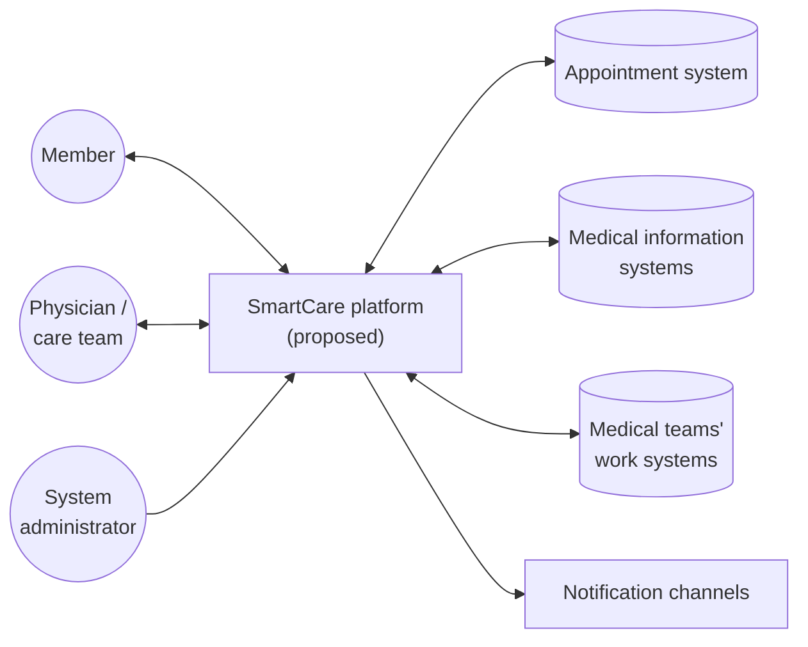
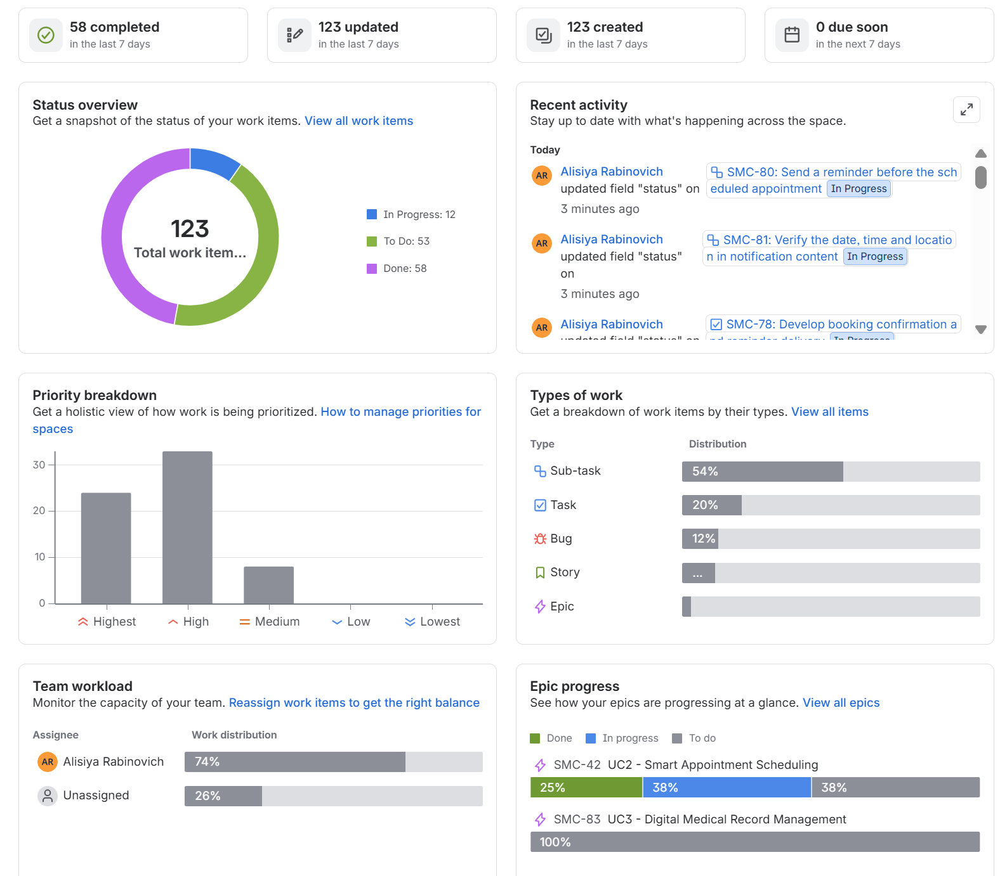
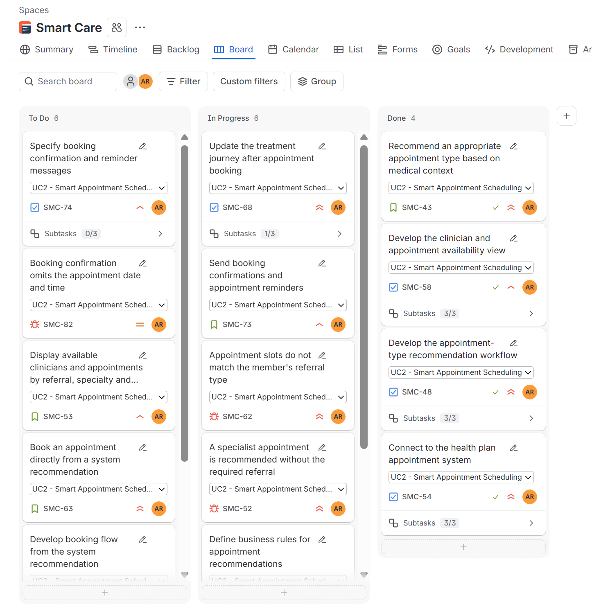

# SmartCare: Healthcare Platform Analysis & Agile Project Planning

## Project Overview

SmartCare is an academic project in **system analysis, business planning and Agile project management**, completed as part of a Software Project Management course in a B.A. in Management Information Systems.

The project defines a proposed digital platform for a health-plan organization: from the business problem and feasibility analysis to user requirements and a Scrum project plan in Jira with **123 work items**.

> SmartCare was analyzed and specified, but not developed or deployed. The Jira work is a project-management simulation.

---

## Business Problem

Health-plan applications support individual actions, such as booking appointments, viewing test results and renewing prescriptions. They do not support the member's care as one continuous process. Members have to track tests, documents and referrals across separate screens on their own. This leads to delays in diagnosis and treatment, duplicate tests, missing information at appointments and extra load on medical staff.

## Proposed Solution

A platform (mobile app and website) that consolidates each member's medical information and presents their **recommended next step**: the right appointment to book, missing tests or documents to complete, and reminders for incomplete actions. Physicians see the same consolidated view, so they can track whether their patients complete the steps defined for them.

## Project Objectives

- Improve continuity of care and reduce delays caused by missing information
- Reduce duplicate tests and repeat requests to medical staff
- Give members and physicians a single, up-to-date view of the treatment process
- Protect sensitive medical information through role-based access control

---

## My Role & Responsibilities

I independently performed systems analysis, business planning, requirements engineering, and Agile project management activities within an academic simulation:

- **System analysis:** defined the business problem, the current and target state, stakeholders and high-level requirements
- **Business planning:** wrote the project charter and feasibility analysis, and classified the project with the NTCP model
- **Requirements definition:** identified three core use cases and wrote 12 user stories with acceptance criteria
- **Work breakdown:** decomposed the stories into 24 tasks and 72 sub-tasks, and added 12 simulated defect scenarios
- **Prioritization:** set priorities for all 123 items based on business value and dependencies
- **Sprint planning:** organized the work into three sprints and simulated progress on a Scrum board in Jira

## Key Deliverables

| Deliverable | Description |
|---|---|
| Project charter | Objectives, justification, requirements, success metrics, milestones, risks, roles |
| Feasibility analysis | Current state, cost of inaction, proposed solution, benefits, time and cost estimate |
| Product backlog | 3 epics, 12 stories, 24 tasks, 72 sub-tasks, 12 bugs |
| Sprint plan | Three sprints, each focused on one epic |

---

## System Analysis & Planning

The analysis identified the platform's users and the existing systems it must integrate with:



Key requirements: integration with existing health-plan systems, information security and medical privacy, AI-assisted recommendations, and an interface suitable for members of all ages.

## Agile / Scrum Simulation

The solution was broken down into three epics and managed in Jira using Scrum:

| Sprint | Epic | Stories | Priority | Simulation Status |
|---|---|:---:|:---:|---|
| Sprint 1 | UC1: Smart Treatment Journey Management | 4 | Highest | Completed |
| Sprint 2 | UC2: Smart Appointment Scheduling | 4 | High | In Progress |
| Sprint 3 | UC3: Digital Medical Record Management | 4 | Highest | Planned |

**3** Epics · **12** Stories · **24** Tasks · **72** Sub-tasks · **12** Bugs = **123 work items**

Work is tracked on a Scrum board with three statuses (To Do → In Progress → Done). The sprint order and statuses come from the reconstructed Jira workspace; the original course plan scheduled UC2 before UC1 (see [Sprint Plan](docs/jira-scrum-project.md#sprint-plan)).

---

## Jira Project Showcase

**Project overview.** The Jira dashboard with all 123 work items, their status distribution, priority breakdown, work-item types and epic progress.



**Scrum board.** The active sprint on the board, with work items in To Do, In Progress and Done, and sub-task progress on each task.



More screenshots (sprint planning, timeline, a user story with acceptance criteria, epic status): [Jira Workspace Screenshots](docs/jira-scrum-project.md#jira-workspace-screenshots).

---

## Project Structure

```
smartcare-project-management/
├── README.md
├── docs/
│   ├── project-initiation.md
│   ├── jira-scrum-project.md
│   └── jira-backlog.csv
└── screenshots/
    ├── 01-project-overview-dashboard.png
    ├── 02-scrum-board.png
    ├── 03-sprint-2-active.png
    ├── 04-sprint-3-planned.png
    ├── 05-project-timeline.png
    ├── 06-user-story-smc-43.png
    └── 07-epics-overview.png
```

## Documentation

| Document | Contents |
|---|---|
| [Project Initiation & Feasibility](docs/project-initiation.md) | Project charter, system context, NTCP classification, feasibility analysis |
| [Jira Scrum Project](docs/jira-scrum-project.md) | Issue hierarchy, prioritization, sprint plan, simulated defect scenarios, Jira screenshots and the complete product backlog |
| [jira-backlog.csv](docs/jira-backlog.csv) | All 123 work items in spreadsheet format, with Jira keys, parent and story relationships, and original and current sprint allocation |

---

## Project Scope & Limitations

- **Academic project:** SmartCare is a proposed system. It was analyzed and planned, not developed or deployed, and no source code is included.
- **Simulated Scrum execution:** sprint statuses and bugs are part of a project-management simulation. The bugs are simulated defect scenarios, not results of real testing.
- **Reconstructed Jira workspace:** the original Jira workspace was deleted after the course. The backlog was reconstructed from the original planning materials and imported into a new Jira Cloud workspace. Sprint assignments, statuses and dates in that workspace are part of the reconstruction, and the sprint order differs from the original course plan.
- **Generic organization:** the health-plan organization is described generically, and no real patient data is used.

---

**Skills:** `Systems Analysis` · `Business Analysis` · `Requirements Engineering` · `Business Process Planning` · `User Stories` · `Acceptance Criteria` · `Feasibility Analysis` · `NTCP Model` · `Backlog Management` · `Prioritization` · `Agile Project Management` · `Scrum` · `Jira`
