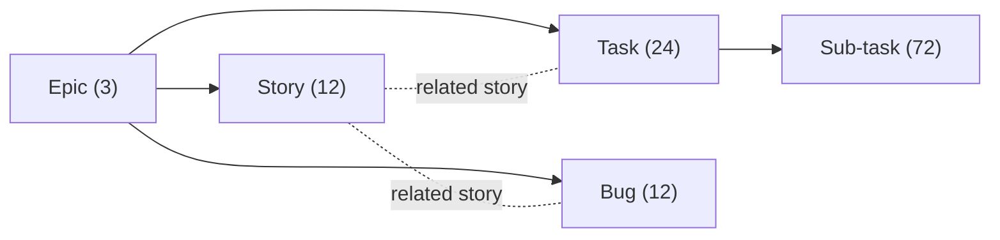
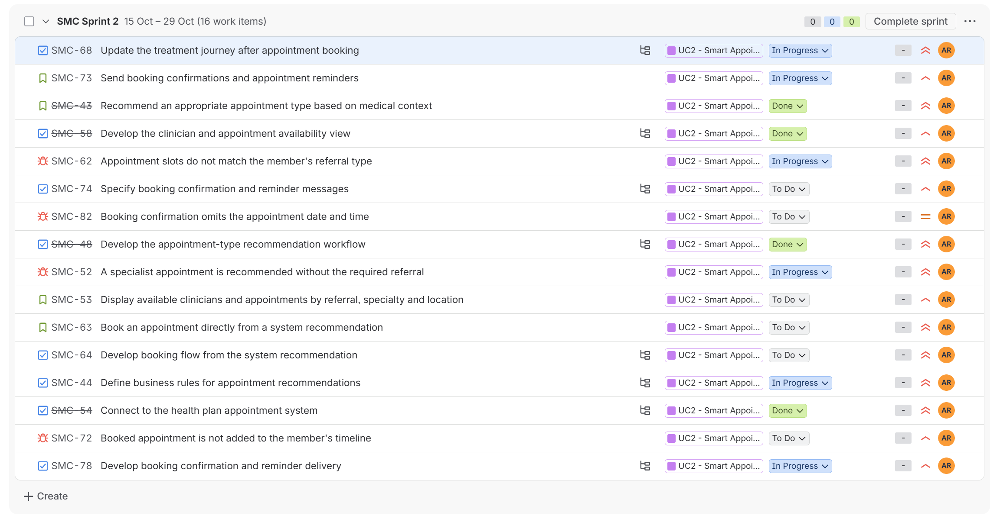
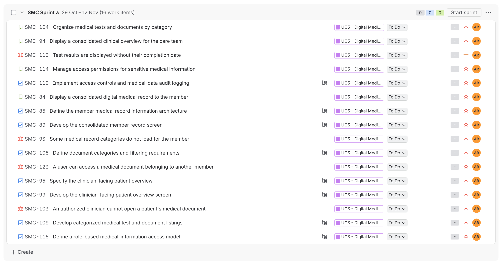
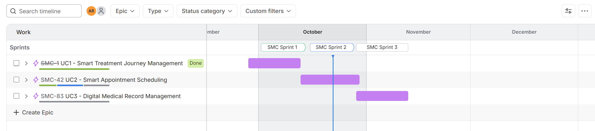
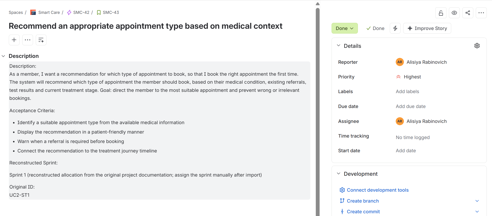
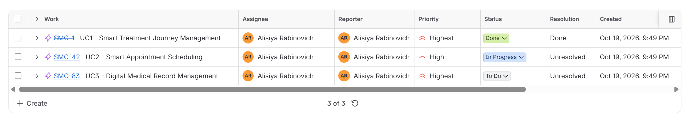

# SmartCare: Jira Scrum Project

This document describes how the SmartCare project was planned and managed in Jira using the Scrum framework, and includes the complete product backlog.

> **Scope note:** this is an academic project-management simulation. The SmartCare system was analyzed and specified but not developed. Sprint statuses represent a reconstructed academic Scrum simulation, not real development progress.

**Contents:** [Project Overview](#project-overview) · [Issue Hierarchy](#issue-hierarchy-and-relationships) · [Prioritization](#prioritization) · [Sprint Plan](#sprint-plan) · [Simulated Defect Scenarios](#simulated-defect-scenarios) · [Documentation Notes](#documentation-notes) · [Screenshots](#jira-workspace-screenshots) · [Product Backlog](#product-backlog)

---

## Project Overview

The backlog is based on the three core use cases defined from the project charter. Each use case is modeled as an **Epic** and broken down into user stories, tasks and sub-tasks.

| Level | Count | Purpose |
|---|---:|---|
| Epic | 3 | A core functional area of the system |
| Story | 12 | A user requirement, with a description and acceptance criteria |
| Task | 24 | Analysis, specification or development work needed to deliver a story |
| Sub-task | 72 | A concrete step within a task |
| Bug | 12 | A simulated defect scenario linked to a story |
| **Total** | **123** | |

Every item has a priority (Highest / High / Medium). The original course workspace used four board statuses (**To Do → In Progress → In Review → Done**). The reconstructed workspace uses Jira's default Scrum workflow with three statuses (**To Do → In Progress → Done**).

The full backlog is also available as a spreadsheet: [jira-backlog.csv](jira-backlog.csv).

---

## Issue Hierarchy and Relationships

The CSV separates **native Jira parent relationships** from **logical story links**, because Jira's standard hierarchy does not allow a Task or Bug to be a child of a Story.

| Issue type | `Parent ID` (Jira hierarchy) | `Related Story` (logical link) |
|---|---|---|
| Epic | none | none |
| Story | Epic | none |
| Task | Epic | The story it delivers |
| Sub-task | Task | The story of its parent task |
| Bug | Epic | The story whose behavior it affects |

In Jira, the logical link corresponds to an issue link such as *relates to*.

---

## Prioritization

| Epic | Priority | Rationale |
|---|---|---|
| UC1: Smart Treatment Journey Management | Highest | The core value of the platform: continuity of care, open treatment steps, missing items and reminders |
| UC2: Smart Appointment Scheduling | High | Essential, but depends on data from the treatment journey and the medical record |
| UC3: Digital Medical Record Management | Highest | A critical foundation: the other capabilities depend on consolidated medical data |

Within each epic, the stories that deliver the main value are rated **Highest**, and the supporting stories are rated **High**.

---

## Sprint Plan

The work is organized into three sprints, each focused on one epic. The current Jira workspace is a reconstruction of the academic Scrum simulation. Its sprint order differs from the order used in the original course presentation, and both are documented below.

### Current Jira Workspace (Reconstruction)

| Sprint | Scope | Simulation Status |
|---|---|---|
| SMC Sprint 1 | UC1: Smart Treatment Journey Management | Completed |
| SMC Sprint 2 | UC2: Smart Appointment Scheduling | In Progress |
| SMC Sprint 3 | UC3: Digital Medical Record Management | Planned |

At the time of the screenshots, the workspace showed **58 Done, 12 In Progress and 53 To Do** out of 123 work items. Sprint 2 items are spread across To Do, In Progress and Done to simulate an active sprint; all Sprint 3 items are in To Do.

### Original Course Plan

| Sprint | Scope | Status in the course presentation |
|---|---|---|
| Sprint 1 | UC2: Smart Appointment Scheduling | Completed |
| Sprint 2 | UC1: Smart Treatment Journey Management | In Progress |
| Sprint 3 | UC3: Digital Medical Record Management | Planned |

In the reconstruction, Sprints 1 and 2 were swapped, so the sprint order now matches the epic numbering. The new order also follows a dependency in the backlog, since the appointment-scheduling stories rely on the treatment journey: booked appointments are added to the treatment timeline (`UC2-ST3`), and recommendations are linked to it (`UC2-ST1`). Sprint 3 is unchanged.

**Reconstructed Sprint Allocation:** the original per-item sprint assignments could not be recovered, so every story, task, sub-task and bug is allocated to its epic's sprint: **40 items per sprint** (4 stories, 8 tasks, 24 sub-tasks and 4 bugs). Epics are not assigned to a single sprint. In [jira-backlog.csv](jira-backlog.csv), the `Original Planned Sprint` column keeps the course allocation and `Jira Workspace Sprint` shows the current one.

Sprint statuses and the dates shown in Jira were set during the reconstruction. They do not record historical progress or real development work. Story points and velocity were not part of the original material and are not shown.

---

## Simulated Defect Scenarios

Each story includes one bug. These are **simulated defect scenarios** written to practice defect management in Jira (logging, prioritizing and linking defects to requirements). They do not describe defects found in a running system, and no testing or fixes were carried out.

Each scenario includes:

- **Expected result**: the behavior required by the story's acceptance criteria;
- **Simulated actual result**: the defective behavior the scenario describes.

Severity follows the impact on members and data privacy: access-control scenarios (`UC1-ST3-B1`, `UC3-ST4-B1`) and violations of core business rules are rated **Highest**.

---

## Documentation Notes

- The original Jira workspace was deleted after the course and is no longer available.
- The backlog was reconstructed from the original planning materials, which list each work item's type, parent, summary, description and priority.
- The item IDs (e.g. `UC1-ST1-T1-S1`) follow the naming convention used during planning, not original Jira issue keys.
- Expected and simulated actual results for the bugs were added for clarity, based on each bug's summary and the related acceptance criteria.
- The backlog was imported into a new Jira Cloud workspace (project key `SMC`). The `Jira Key` column in the CSV maps each planning ID to its Jira key, e.g. `UC2-ST1` = `SMC-43`.
- During the import, the planning ID, the related story and the originally planned sprint were stored in each Jira item's description, because Jira has no standard fields for them. Some descriptions in the Jira workspace still contain the original sprint number and an import note ("assign the sprint manually after import"). Where they differ, the sprint shown in the Jira **Sprint** field is the current one.

---

## Jira Workspace Screenshots

Screenshots from the reconstructed Jira Cloud workspace.

### Sprint Planning

**Sprint 2 (active).** The 16 parent items of UC2 (stories, tasks and bugs) are in different workflow statuses, which simulates a sprint in progress. Sub-tasks are nested under their tasks.

**Sprint 3 (planned).** All UC3 items are planned and in To Do, and the sprint has not been started.

### Scrum Workflow

The board for the active sprint, with To Do, In Progress and Done columns. Each task card shows its sub-task progress (for example 1/3 or 3/3).

### Project Timeline

The three epics and three sprints on the Jira timeline: UC1 is completed, UC2 is in progress and UC3 is planned.

### User Story and Acceptance Criteria

Story `SMC-43` (`UC2-ST1`) under epic `SMC-42`, with its user story, description, acceptance criteria, priority and planning ID. The description still shows the originally planned sprint and an import note from the reconstruction (see [Documentation Notes](#documentation-notes)).

### Epic Status

The three epics with their priority, status and resolution.

---

## Product Backlog

The backlog is organized by epic and story. Each story includes its user story, description, acceptance criteria, tasks with sub-tasks, and a simulated bug scenario.

---

### UC1 — Smart Treatment Journey Management

**Priority:** Highest · **Jira Sprint:** Sprint 1 (Completed) · **Original plan:** Sprint 2

**Goal:** Show each member the appropriate next medical step, based on existing medical information, tests, referrals, appointments and missing documents.

#### Story 1.1 — Display the member's treatment journey timeline

**ID:** `UC1-ST1` · **Priority:** Highest

> As a **member**, I want to see my treatment journey as a timeline, so that I know what has been done and what my next step is.

The system will show the member a clear timeline of their personal care process, including tests, appointments, referrals, missing documents, prescriptions and open treatment steps.

**Goal:** help the member understand which stage they are at, what has already been done and what they need to do next.

**Acceptance criteria**

- Display treatment steps in chronological order.
- Show a status for each step: completed, pending, missing information or action required.
- Highlight the next recommended action.
- Refresh displayed information from relevant health-plan systems.

**Tasks and sub-tasks**

1. **Define the treatment timeline structure** *(Highest)*
   - Define medical event types displayed on the timeline *(Highest)*
   - Define status labels for each treatment step *(Highest)*
   - Define display order by date and treatment sequence *(High)*
2. **Develop the member timeline screen** *(Highest)*
   - Design responsive timeline layouts for mobile and web *(High)*
   - Connect the timeline to tests, appointments, referrals and documents *(Highest)*
   - Highlight the member's recommended next step *(Highest)*

**Simulated bug:** Medical events appear in the wrong chronological order *(High)*

- Expected result: Events are listed chronologically: test → referral → appointment.
- Simulated actual result: Events appear out of order (e.g. the March test is shown after the May appointment).

 

#### Story 1.2 — Display missing tests and documents before an appointment

**ID:** `UC1-ST2` · **Priority:** Highest

> As a **member**, I want to see which tests or documents are missing before an appointment, so that I arrive prepared and my care is not delayed.

The system will check which tests, documents or referrals are required before a medical appointment and show the member a clear list of what is missing.

**Goal:** prevent members from arriving at an appointment without required information, which can delay diagnosis or treatment.

**Acceptance criteria**

- Identify required documents and tests according to appointment type.
- Compare required items with the existing medical record.
- Clearly display outstanding requirements.
- Show a readiness message if no information is missing.

**Tasks and sub-tasks**

1. **Define appointment-specific test and document requirements** *(Highest)*
   - Identify required documents by specialty or examination type *(Highest)*
   - Identify tests that must be completed before appointments *(High)*
   - Review requirements with a clinical stakeholder *(High)*
2. **Develop missing-test and missing-document detection** *(Highest)*
   - Compare appointment requirements against the medical record *(Highest)*
   - Present outstanding requirements clearly to the member *(Highest)*
   - Display a readiness message when nothing is missing *(Medium)*

**Simulated bug:** An existing medical document is incorrectly flagged as missing *(Highest)*

- Expected result: The letter is recognized; if nothing else is missing, the 'You're ready' message is shown.
- Simulated actual result: The letter is still listed as missing.

 

#### Story 1.3 — Display outstanding treatment steps to authorized clinicians

**ID:** `UC1-ST3` · **Priority:** High

> As a **physician**, I want to see whether my patient has completed the treatment steps required of them, so that I can follow up and keep continuity of care.

The system will let the care provider see the patient's open treatment steps, including completed actions, actions not yet completed and existing gaps.

**Goal:** give the physician or care provider a quick status picture and improve continuity of care.

**Acceptance criteria**

- Show outstanding treatment steps for each relevant patient.
- Display an up-to-date status for each step.
- Identify missing tests, referrals and documents.
- Allow access only to authorized care professionals.

**Tasks and sub-tasks**

1. **Specify the clinician's treatment-step tracking screen** *(High)*
   - Define the patient information shown to each clinician *(High)*
   - Define statuses for outstanding treatment steps *(High)*
   - Specify viewing permissions by clinical role *(Highest)*
2. **Develop the display of pending patient treatment steps** *(High)*
   - Display a list of outstanding treatment steps *(High)*
   - Show missing tests, referrals and documents *(High)*
   - Allow an authorized clinician to mark a step complete *(Medium)*

**Simulated bug:** A clinician can see treatment steps for an unrelated patient *(Highest)*

- Expected result: Only patients under Physician A's care are listed.
- Simulated actual result: The list includes a patient with no care relationship to Physician A.

 

#### Story 1.4 — Notify members about incomplete medical actions

**ID:** `UC1-ST4` · **Priority:** High

> As a **member**, I want to be notified when a medical action is still incomplete, so that I don't miss a test, document or appointment.

The system will notify the member when medical actions are still incomplete - for example a test, a document upload, booking an appointment or renewing a referral.

**Goal:** help members complete treatment steps on time and reduce delays in the care process.

**Acceptance criteria**

- Detect medical actions that remain incomplete.
- Deliver notifications through an appropriate channel: push, SMS or email.
- Explain which action the patient should take.
- Prevent duplicate notifications for the same action.

**Tasks and sub-tasks**

1. **Define triggers for medical-action notifications** *(High)*
   - Identify incomplete actions that trigger a reminder *(High)*
   - Specify notification frequency *(Medium)*
   - Define safeguards against duplicate notifications *(High)*
2. **Develop member notification delivery** *(High)*
   - Implement push notifications *(High)*
   - Implement email and SMS notifications *(Medium)*
   - Verify notifications are delivered to members *(High)*

**Simulated bug:** Duplicate reminders are sent for the same incomplete action *(Medium)*

- Expected result: One notification is sent, per the defined frequency rule.
- Simulated actual result: The member receives the same notification twice.

---

### UC2 — Smart Appointment Scheduling

**Priority:** High · **Jira Sprint:** Sprint 2 (In Progress) · **Original plan:** Sprint 1

**Goal:** Let members book a suitable appointment based on medical need, existing referral, clinician availability and treatment stage.

#### Story 2.1 — Recommend an appropriate appointment type based on medical context

**ID:** `UC2-ST1` · **Priority:** Highest

> As a **member**, I want a recommendation for which type of appointment to book, so that I book the right appointment the first time.

The system will recommend which type of appointment the member should book, based on their medical condition, existing referrals, test results and current treatment stage.

**Goal:** direct the member to the most suitable appointment and prevent wrong or irrelevant bookings.

**Acceptance criteria**

- Identify a suitable appointment type from the available medical information.
- Display the recommendation in a patient-friendly manner.
- Warn when a referral is required before booking.
- Connect the recommendation to the treatment journey timeline.

**Tasks and sub-tasks**

1. **Define business rules for appointment recommendations** *(Highest)*
   - Map medical needs to suitable appointment types *(Highest)*
   - Define when a referral is required before booking *(High)*
   - Write explanatory messages for members *(Medium)*
2. **Develop the appointment-type recommendation workflow** *(Highest)*
   - Retrieve relevant context from the medical record *(Highest)*
   - Display the recommended appointment type *(Highest)*
   - Link recommendations to the treatment journey timeline *(High)*

**Simulated bug:** A specialist appointment is recommended without the required referral *(Highest)*

- Expected result: The system warns that a referral is required and does not offer the specialist appointment as bookable.
- Simulated actual result: A specialist appointment is recommended without any referral warning.

 

#### Story 2.2 — Display available clinicians and appointments by referral, specialty and location

**ID:** `UC2-ST2` · **Priority:** High

> As a **member**, I want to see available clinicians that match my referral and location, so that I can choose a suitable slot quickly.

The system will show the member a list of available clinicians and appointments according to referral type, medical field, the member's location and slot availability.

**Goal:** let the member choose a suitable appointment quickly and easily.

**Acceptance criteria**

- Display only appointment slots matching the referral or clinical need.
- Allow filters by location, specialty and date.
- Display clinician, facility, date and time details.
- Show a clear message if no appointments are available.

**Tasks and sub-tasks**

1. **Connect to the health plan appointment system** *(Highest)*
   - Review the API for retrieving available appointment slots *(Highest)*
   - Retrieve clinicians by specialty *(High)*
   - Retrieve availability by location and date *(High)*
2. **Develop the clinician and appointment availability view** *(High)*
   - Display available clinicians and appointment slots *(High)*
   - Add filters for location, specialty and date *(Medium)*
   - Show an informative empty state when no appointments are available *(Medium)*

**Simulated bug:** Appointment slots do not match the member's referral type *(Highest)*

- Expected result: Only orthopedics slots are shown.
- Simulated actual result: Slots from unrelated specialties are also shown.

 

#### Story 2.3 — Book an appointment directly from a system recommendation

**ID:** `UC2-ST3` · **Priority:** Highest

> As a **member**, I want to book directly from the recommendation I received, so that I don't have to start a new search.

The system will let the member book directly from the recommendation shown, without moving to unrelated screens or searching again manually.

**Goal:** a continuous flow - recommendation → slot selection → confirmation → care-process update.

**Acceptance criteria**

- Allow selection of an appointment from recommended options.
- Save the appointment after confirmation.
- Add the appointment to the treatment timeline.
- Display a booking confirmation to the patient.

**Tasks and sub-tasks**

1. **Develop booking flow from the system recommendation** *(Highest)*
   - Add a booking action to the recommendation view *(Highest)*
   - Display appointment details before confirmation *(High)*
   - Save the selected appointment in the booking system *(Highest)*
2. **Update the treatment journey after appointment booking** *(Highest)*
   - Add the booked appointment to the medical timeline *(High)*
   - Update the treatment-step status after booking *(High)*
   - Display booking confirmation to the member *(Medium)*

**Simulated bug:** Booked appointment is not added to the member's timeline *(High)*

- Expected result: The new appointment appears on the timeline and the step status changes to 'Appointment booked'.
- Simulated actual result: The booking is saved in the appointment system but does not appear on the timeline.

 

#### Story 2.4 — Send booking confirmations and appointment reminders

**ID:** `UC2-ST4` · **Priority:** High

> As a **member**, I want a confirmation and a reminder after booking, so that I remember the appointment and arrive prepared.

The system will send the member a confirmation after booking and a reminder before the appointment.

**Goal:** reduce missed appointments and make sure the member arrives with the required documents and tests.

**Acceptance criteria**

- Send a confirmation after an appointment is booked.
- Include the date, time, location and clinician or service.
- Send a reminder before the appointment.
- Include missing-document information when relevant.

**Tasks and sub-tasks**

1. **Specify booking confirmation and reminder messages** *(High)*
   - Define required content for booking confirmations *(High)*
   - Define when pre-appointment reminders should be sent *(Medium)*
   - Include missing-document information in reminders *(High)*
2. **Develop booking confirmation and reminder delivery** *(High)*
   - Send a confirmation after booking *(High)*
   - Send a reminder before the scheduled appointment *(Medium)*
   - Verify the date, time and location in notification content *(High)*

**Simulated bug:** Booking confirmation omits the appointment date and time *(Medium)*

- Expected result: The message includes date, time, location and clinician/service.
- Simulated actual result: The message is sent without the date and time.

---

### UC3 — Digital Medical Record Management

**Priority:** Highest · **Jira Sprint:** Sprint 3 (Planned) · **Original plan:** Sprint 3

**Goal:** Give members and clinicians consolidated, up-to-date and clear medical information: tests, documents, referrals, medications, appointments and history.

#### Story 3.1 — Display a consolidated digital medical record to the member

**ID:** `UC3-ST1` · **Priority:** Highest

> As a **member**, I want to view my medical record in one place, so that I don't have to search across separate screens.

The system will present a consolidated digital medical record that includes relevant information such as tests, documents, referrals, appointments, medications and follow-up data.

**Goal:** let the member see their medical information in one place, clearly and accessibly.

**Acceptance criteria**

- Allow patients to view their consolidated medical record.
- Organize medical information into clear categories.
- Make the information easy to understand.
- Update the record from relevant health-plan systems.

**Tasks and sub-tasks**

1. **Define the member medical record information architecture** *(Highest)*
   - Define categories within the digital medical record *(Highest)*
   - Define member-visible information for each category *(High)*
   - Specify a clear and accessible presentation of medical information *(High)*
2. **Develop the consolidated member record screen** *(Highest)*
   - Develop the tests and documents section *(High)*
   - Develop the referrals, appointments and medications section *(High)*
   - Connect the member record to relevant health-plan data *(Highest)*

**Simulated bug:** Some medical record categories do not load for the member *(High)*

- Expected result: All categories (tests, documents, referrals, medications, appointments) load.
- Simulated actual result: Some categories do not load and appear empty.

 

#### Story 3.2 — Display a consolidated clinical overview for the care team

**ID:** `UC3-ST2` · **Priority:** High

> As a **physician**, I want a consolidated clinical overview of my patient, so that I can prepare quickly without switching between systems.

The system will give the care provider a consolidated clinical overview of the patient, including up-to-date tests, referrals, medications, documents and open treatment steps.

**Goal:** help the care provider understand the patient's status quickly and make treatment decisions more efficiently.

**Acceptance criteria**

- Present key medical information to an authorized clinician.
- Show outstanding treatment steps and missing items.
- Show recent tests and documents.
- Restrict access to authorized users.

**Tasks and sub-tasks**

1. **Specify the clinician-facing patient overview** *(High)*
   - Define key patient information for the overview *(High)*
   - Define how outstanding treatment steps will appear *(High)*
   - Define how recent tests and documents will appear *(High)*
2. **Develop the clinician-facing patient overview screen** *(High)*
   - Display basic patient details *(Medium)*
   - Display key medical information *(High)*
   - Enable access to medical documents from the overview *(High)*

**Simulated bug:** An authorized clinician cannot open a patient's medical document *(High)*

- Expected result: The document opens.
- Simulated actual result: An access error is shown, although the physician is authorized.

 

#### Story 3.3 — Organize medical tests and documents by category

**ID:** `UC3-ST3` · **Priority:** High

> As a **member**, I want to see test results and medical documents organized by category, so that I can find a specific item easily.

The system will present test results and medical documents to the member and care provider, organized by category, document type and date.

**Goal:** enable fast retrieval of medical information and avoid confusion between documents.

**Acceptance criteria**

- Organize results and documents by category.
- Allow filtering by document type, date or medical specialty.
- Display each item’s name, date and status.
- Allow opening a document or result from the list.

**Tasks and sub-tasks**

1. **Define document categories and filtering requirements** *(High)*
   - Define categories for medical documents *(High)*
   - Specify filters for document type, date and clinical area *(Medium)*
   - Define metadata shown for each document or test result *(High)*
2. **Develop categorized medical test and document listings** *(High)*
   - Build a list of medical documents and test results *(High)*
   - Implement search and filtering controls *(Medium)*
   - Allow users to open documents and results from the list *(High)*

**Simulated bug:** Test results are displayed without their completion date *(Medium)*

- Expected result: Each item shows name, date and status.
- Simulated actual result: Test results are shown without the date the test was performed.

 

#### Story 3.4 — Manage access permissions for sensitive medical information

**ID:** `UC3-ST4` · **Priority:** Highest

> As a **system administrator**, I want to ensure that only authorized users can access medical information, so that patient privacy is protected and every access is traceable.

The system will manage access to sensitive medical information by user type and role, so that only authorized parties can view it.

**Goal:** protect patient privacy and meet information-security and medical-privacy requirements, which were defined as a key project constraint.

**Acceptance criteria**

- Define permissions for patients, physicians, other care professionals and administrators.
- Block unauthorized users from viewing sensitive medical information.
- Record access to medical information in an audit log.
- Reject invalid access attempts and display an appropriate message.

**Tasks and sub-tasks**

1. **Define a role-based medical-information access model** *(Highest)*
   - Define access rules for members, physicians, care teams and administrators *(Highest)*
   - Define restrictions based on the patient's care relationship *(Highest)*
   - Review the access model with information security stakeholders *(Highest)*
2. **Implement access controls and medical-data audit logging** *(Highest)*
   - Block unauthorized users from accessing sensitive information *(Highest)*
   - Log access to medical information in an audit trail *(High)*
   - Test invalid and unauthorized access attempts *(Highest)*

**Simulated bug:** A user can access a medical document belonging to another member *(Highest)*

- Expected result: Access is denied, an appropriate message is shown and the attempt is written to the audit log.
- Simulated actual result: Member B's document is displayed to Member A.
