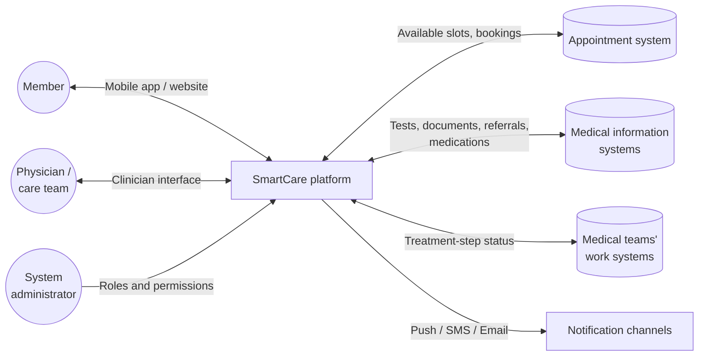
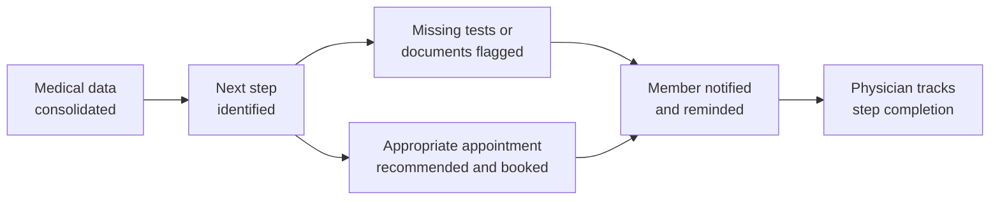

# SmartCare: Project Initiation & Feasibility Analysis

This document defines the SmartCare project and evaluates its business feasibility.

> **Scope note:** SmartCare is an academic system-analysis and project-planning project. The platform described here was analyzed and specified, but not developed or deployed.

**Contents:** [Project Charter](#project-charter) · [Feasibility Analysis](#feasibility-analysis)

---

# Project Charter

## Project Description

**SmartCare** is a smart platform for managing each member's medical process continuously and in a personalized way. It consolidates information from multiple sources and supports health-plan members throughout the diagnosis and treatment of illnesses, medical conditions and injuries.

## Objective and Justification

**Objective:** improve how the medical process is managed for health-plan members by creating a continuous, coordinated treatment journey that is easy to follow.

**Justification:** members currently manage information, documents, referrals and coordination between care providers on their own. This leads to:

- delays and poor coordination between treatment stages;
- lower-quality follow-up, which can worsen members' health and lead to more expensive tests and treatments;
- lower member satisfaction and damage to the organization's reputation.

The project also supports the organization's goals for availability, medical quality, operational efficiency and satisfaction.

## Stakeholders and Users

| Group | Role |
|---|---|
| Health-plan members | Primary users |
| Physicians and medical teams | Follow up on treatment steps defined for their patients |
| Administrative staff | Support the treatment process |

## Deliverables

A platform (mobile app and website) that presents each member with their recommended next steps:

- booking the appropriate appointment;
- completing missing tests and documents before a specialist visit;
- renewing prescriptions and unused referrals;
- structured guidance based on existing medical data and clinical guidelines.

The platform also includes an interface synchronized with the medical teams' systems, so clinicians can track whether their patients complete the defined steps.

## High-Level Requirements

| # | Requirement |
|---|---|
| R1 | Integration with the appointment system, medical teams' systems, medical records and databases |
| R2 | Compliance with information-security and medical-privacy requirements |
| R3 | Artificial-intelligence components |
| R4 | An intuitive, clear interface suitable for members of all ages |

### System Context

The conceptual context below shows the users and the existing systems SmartCare must integrate with (R1). It describes the planned scope only, not a technical implementation.

## Success Metrics

The project's impact is expected to be measurable within **3–5 years** of implementation:

- increase in member satisfaction;
- fewer medical processes delayed by missing documents, tests or information;
- higher completion rates for referrals, tests and medical recommendations;
- improved operational efficiency;
- improved Ministry of Health indicators for medical quality, availability, accessibility and continuity of care;
- platform adoption and the completion rate of the treatment steps defined for each member.

## Delivery Approach and Milestones

The project follows a **phased approach**, which allows ongoing control, reduces risk and enables adjustments before advancing to the next phase.

**Milestones:** requirements approval → solution and interface design → development completion → system and security testing → pilot → phased rollout

**Estimated duration:** approximately 12 months

## Key Risks

| Risk | Potential impact |
|---|---|
| System integration complexity | Quality, schedule |
| Development or implementation delays | Schedule |
| Budget overrun | Cost, scope |
| User resistance to change | Adoption |
| Adoption of new work processes | Adoption |
| Information-security and medical-privacy challenges | Quality, compliance |

## Project Classification (NTCP Model)

| Dimension | Level | Rationale |
|---|---|---|
| **Novelty** | Platform | A new solution in an existing domain, not an upgrade of an existing application |
| **Technology** | Medium-tech | Established technologies, combined through integration |
| **Complexity** | Array | Multiple subsystems, interfaces and external parties |
| **Pace** | Fast / Competitive | Competition between health plans makes timely delivery a priority |

## Resources and Roles

**Resources:** development tools, cloud services, databases, information-security components and supporting infrastructure.

**Key roles:** systems analyst, project manager, development team, UI/UX designer, QA engineers and information-security specialists.

**Project manager:** Alisiya Rabinovich, responsible for leading the project, coordinating stakeholders, tracking progress and managing change.

## Budget and Approval Criteria

**Budget:** an initial high-level estimate covering requirements, development, testing, implementation, information security, cloud services and infrastructure. It will be refined once the final scope is defined.

**Approval criteria:** management and budget approval, a business feasibility review, clearly defined goals and scope, appointment of key roles, available resources, and organizational agreement on integration with existing systems.

---

# Feasibility Analysis

## Current State Analysis

Existing health-plan applications support individual actions such as booking appointments, viewing test results, renewing prescriptions and contacting the clinic. They do not manage the member's care as a single, continuous process. Information is spread across separate screens, and members must track their own tests, documents and referrals.

**Impact:**

- delays in diagnosis and treatment;
- suboptimal appointment scheduling;
- missing documents or information at appointments;
- duplicate tests and increased demand for specialists;
- members abandoning the diagnostic process.

## Cost of Inaction

If the current state continues, delays will persist and members' health may deteriorate. Service centers, medical teams and specialists will remain overloaded, waiting times and duplicate tests will increase, and member satisfaction and retention will decline. Ongoing waste of time and resources will keep operating costs high.

## Proposed Solution

A new platform (mobile app and website) that acts as a **smart care manager** for each member. By cross-referencing medical data, the system identifies each member's next step. Physicians see the same consolidated view, so they can follow up on the steps defined for each patient.

### Target Business Process

The solution was later broken down into three core use cases, managed as epics in Jira: **Smart Treatment Journey Management**, **Smart Appointment Scheduling** and **Digital Medical Record Management**. See [Jira Scrum Project](jira-scrum-project.md).

## Expected Benefits

| Stakeholder | Benefits |
|---|---|
| Members | Faster diagnosis and treatment, improved continuity of care |
| Medical teams | Time savings, fewer repeat requests |
| Organization | Fewer duplicate tests, better resource utilization, improved quality indicators, stronger competitive position |

## Estimated Duration and Cost

| | Estimate | Main drivers |
|---|---|---|
| **Duration** | ~12 months | App and website development, system integration, data consolidation, testing, security compliance, rollout |
| **Cost** | High | Technology development, integration and AI-based components |

**Conclusion:** the project requires a significant investment, which is justified by long-term reductions in waste and duplication, improved efficiency and higher service quality.
